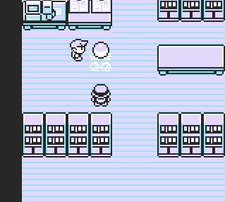

## Pushie

A script that gives you the ability to push map objects or NPCs!

# 

- Pressing button B infront of an npc/object allows you to push it.

The script uses **Map Script Pointer** manipulation, which temporarily prevents normal game events. To restore them and unload the script, simply **leave the room and re-enter it**.

---

**Red/Blue**
```
21 6e d3 3e bf 22 3e d8 77 c9  
f0 b3 cb 4f c8 21 28 d7 cb c6  
21 60 cd cb ce c9
```

**Yellow**
```
21 6d d3 3e be 22 3e d8 77 c9  
f0 b3 cb 4f c8 21 27 d7 cb c6  
21 60 cd cb ce c9
```