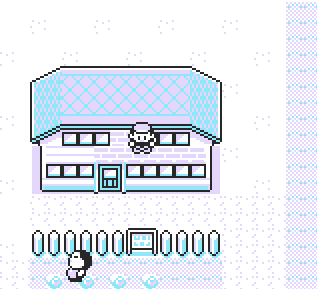


## SimpleWTW

Enables walk-through-walls while Button B is held down.


# 


It requires [DMA Activator](https://github.com/imanoz/PokemonACE/tree/main/Tools/Templates/DMA%20Scripts) to constantly run in the backround.
To stop the script, simply **reset the game** or use the universal **DMA Unloader**.

###  ⚠ Warnings
- Using the script means that you can easily go outside of current map, giving an instant crash and a possible savegame corruption. For this reason, you are advised to use [AntiCollision+ script](https://github.com/imanoz/PokemonACE/tree/main/Mechanics/%5BP%5D%20AntiCollision%2B) instead!


---

**Red/Blue**
```
21 c2 d8 4e 23 11 1d df f3 cd  
3a 12 d9 0d f0 f8 cb 4f 3e 00
28 01 3c ea 38 cd c9
```

**Yellow**
```
21 c1 d8 4e 23 11 1d df f3 cd  
ac 0e d9 0d f0 f5 cb 4f 3e 00
28 01 3c ea 38 cd c9
```
